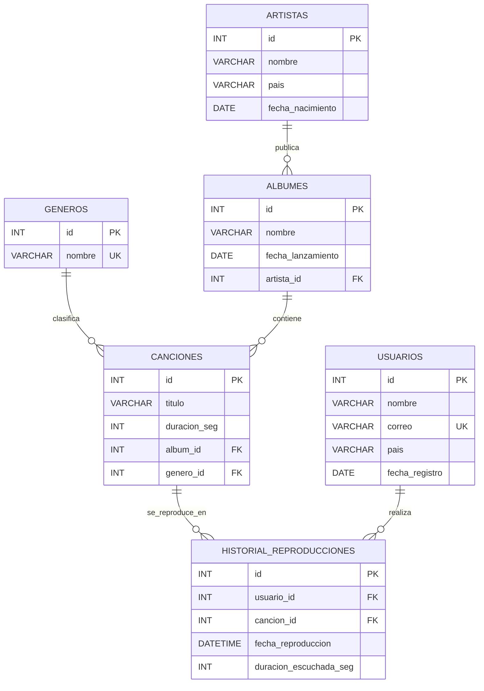

# Analytics Musical — PHP + MySQL (BDDR)

Aplicación de demostración que traduce la base de datos JSON original (`data/database.json`) a una base de datos relacional en **MySQL** (incluyendo una nueva tabla de `usuarios`) y conecta la interfaz web existente mediante **PHP (PDO)**.

## Estructura del proyecto

- `sql/database.sql`: Script DDL + DML para crear la base de datos `ucg_music`, sus 6 tablas, llaves primarias/foráneas, índices y todos los registros iniciales (6 géneros, 10 artistas, 12 álbumes, 26 canciones, 5 usuarios y 65 reproducciones).
- `sql/consultas.sql`: Catálogo de consultas SQL de demostración (Bloques A–F) con `COUNT`, `SUM`, `AVG`, `MIN`, `MAX`, `GROUP BY`, `HAVING`, `INNER JOIN`, `LEFT JOIN`, `ORDER BY`, `LIMIT`, `WHERE`, `BETWEEN` y funciones de fecha (`YEAR`, `MONTH`, `DAYOFWEEK`).
- `config/db.php`: Conexión PDO hacia MySQL (configurable por variables de entorno o editando los valores por defecto).
- `api/estadisticas.php`: Endpoint JSON que ejecuta las consultas SQL en vivo según los filtros (`usuario_id`, `anio`, `trimestre`).
- `api/reproduccion.php`: Endpoint `POST` sencillo para registrar una nueva reproducción de demostración en MySQL y refrescar el panel al instante.
- `index.php`: Interfaz web principal con KPIs, 4 gráficos (Chart.js), rankings de canciones/artistas y tabla interactiva de usuarios.
- `js/app.js` y `js/chartsManager.js`: Lógica de frontend y renderizado de gráficos.
- `css/styles.css`: Estilos del tablero.

## Modelo Relacional



## Diccionario de Datos

| Tabla | Columna | Tipo | Restricciones | Descripción |
| :--- | :--- | :--- | :--- | :--- |
| `generos` | `id` | `INT UNSIGNED` | `PK, AUTO_INCREMENT` | Identificador del género |
| `generos` | `nombre` | `VARCHAR(80)` | `NOT NULL, UNIQUE` | Nombre del género musical |
| `artistas` | `id` | `INT UNSIGNED` | `PK, AUTO_INCREMENT` | Identificador del artista |
| `artistas` | `nombre` | `VARCHAR(120)` | `NOT NULL` | Nombre artístico o banda |
| `artistas` | `pais` | `VARCHAR(80)` | `NOT NULL, INDEX` | País de origen |
| `artistas` | `fecha_nacimiento` | `DATE` | `NOT NULL` | Fecha de nacimiento o formación |
| `albumes` | `id` | `INT UNSIGNED` | `PK, AUTO_INCREMENT` | Identificador del álbum |
| `albumes` | `nombre` | `VARCHAR(150)` | `NOT NULL` | Título del álbum |
| `albumes` | `fecha_lanzamiento` | `DATE` | `NOT NULL` | Fecha de lanzamiento |
| `albumes` | `artista_id` | `INT UNSIGNED` | `NOT NULL, FK -> artistas(id)` | Artista autor del álbum |
| `canciones` | `id` | `INT UNSIGNED` | `PK, AUTO_INCREMENT` | Identificador de la canción |
| `canciones` | `titulo` | `VARCHAR(150)` | `NOT NULL` | Título de la canción |
| `canciones` | `duracion_seg` | `INT UNSIGNED` | `NOT NULL, CHECK (> 0)` | Duración en segundos |
| `canciones` | `album_id` | `INT UNSIGNED` | `NOT NULL, FK -> albumes(id)` | Álbum al que pertenece |
| `canciones` | `genero_id` | `INT UNSIGNED` | `NOT NULL, FK -> generos(id)` | Género musical |
| `usuarios` | `id` | `INT UNSIGNED` | `PK, AUTO_INCREMENT` | Identificador del usuario |
| `usuarios` | `nombre` | `VARCHAR(120)` | `NOT NULL` | Nombre completo del usuario |
| `usuarios` | `correo` | `VARCHAR(150)` | `NOT NULL, UNIQUE` | Correo electrónico |
| `usuarios` | `pais` | `VARCHAR(80)` | `NOT NULL` | País de residencia |
| `usuarios` | `fecha_registro` | `DATE` | `NOT NULL` | Fecha de alta |
| `historial_reproducciones` | `id` | `INT UNSIGNED` | `PK, AUTO_INCREMENT` | Identificador de reproducción |
| `historial_reproducciones` | `usuario_id` | `INT UNSIGNED` | `NOT NULL, FK -> usuarios(id)` | Usuario que reprodujo |
| `historial_reproducciones` | `cancion_id` | `INT UNSIGNED` | `NOT NULL, FK -> canciones(id)` | Canción reproducida |
| `historial_reproducciones` | `fecha_reproduccion` | `DATETIME` | `NOT NULL, INDEX` | Fecha y hora de la reproducción |
| `historial_reproducciones` | `duracion_escuchada_seg` | `INT UNSIGNED` | `NOT NULL, CHECK (>= 0)` | Segundos reproducidos |

## Cómo ejecutar la demostración

1. **Importar la base de datos en MySQL** (desde terminal, phpMyAdmin o MySQL Workbench):
   ```bash
   mysql -u root -p < sql/database.sql
   ```
2. **Configurar credenciales** (opcional):
   Por defecto `config/db.php` usa `host=127.0.0.1`, `port=3306`, `dbname=ucg_music`, `user=root`, `pass="1234"`. Puedes editar `config/db.php` o pasar variables de entorno (`DB_HOST`, `DB_PORT`, `DB_NAME`, `DB_USER`, `DB_PASS`).
3. **Levantar el servidor PHP local**:
   ```bash
   php -S localhost:8000
   ```
   (También funciona copiando la carpeta dentro de `htdocs/` en XAMPP o MAMP.)
4. **Abrir en el navegador**: `http://localhost:8000`
